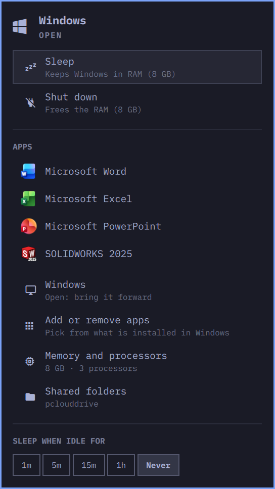

<h1 align="center">Windows Apps for Omarchy</h1>

<p align="center">
  Word, CorelDRAW, SOLIDWORKS or any other Windows program, one double-click away on your Omarchy desktop,<br>
  opening and saving your Linux files where they are.
</p>

<p align="center">
  
</p>

Omarchy can already run Windows in a virtual machine (Install > Windows). This
plugin turns that VM into a source of apps:

- **Windows in one window.** Windows is a single window on your desktop that
  tiles, floats and switches like any other, with its own desktop and taskbar
  inside. Its menus and dialogs stay inside it, where Windows draws them, and
  the Super key stays Omarchy's, while Super+C, V, X and A copy, paste, cut
  and select all in Windows as they do everywhere else.
- **Your files, in place.** Double-click a `.docx`, `.cdr` or `.sldprt` in the
  file manager and it opens in the Windows app, in that window, which comes
  forward. Save, and the Linux file is updated. Nothing is copied into the VM
  and there is no sync folder.
- **Any program you install.** Install software from the Windows desktop, then
  tick it in a checklist. It gets a launcher entry, its real icon and its file
  types. Around 40 common programs are recognised by name; everything else
  works too.
- **The VM looks after itself.** It boots when you open an app or a file
  (about 15 seconds from off; under a second once the window is open) and goes
  to sleep a few minutes after you close its window: paused, using no
  processor, with your apps and unsaved work as you left them. It wakes in
  seconds. Shut it down when you want its memory back.
- **A bar widget** shows whether Windows is on, asleep or off, opens apps, and
  turns it on, puts it to sleep or shuts it down.

## Install

You need Omarchy 4 with the Windows VM installed: Omarchy menu > Install >
Windows, or `omarchy-windows-vm install`. (If you install this plugin first, its
panel offers to do that for you.)

```bash
omarchy plugin add https://github.com/ryancoxrbc/omarchy-winapp --enable
~/.config/omarchy/plugins/ryancoxrbc.winapp/setup
```

The first line clones the plugin and puts the widget in the bar. The second
finishes the job: it puts the `winapp` command on your `PATH`, starts Windows
once to prepare it, and shows the programs it found so you can pick the ones
you want. Run it again whenever something seems off; it only fixes what is
missing.

## Adding an app

Say you want CorelDRAW.

1. **Install it in Windows.** Open *Windows* from the app launcher or the
   panel (or run `winapp desktop`). The folders you share are there under
   *This PC*.
   An installer can also be started from Linux directly, wherever it is:
   `winapp run ~/Downloads/CorelDRAW-Setup.exe`.
2. **Tick it.** Choose *Add or remove apps* in the panel (or run `winapp
   manage`), tick CorelDRAW, press Enter.

That is all. CorelDRAW is now in the app launcher and the panel, with its own
icon, and `.cdr` files open in it.

Prefer the command line?

```bash
winapp scan corel          # what is installed, filtered
winapp add coreldraw       # add it by the id the scan showed
winapp coreldraw ~/Designs/logo.cdr
```

A program the scan does not show, or one you want set up differently, can be
described by hand:

```bash
winapp add signtool --name "Sign Tool" \
    --exe 'C:\Program Files\SignTool\signtool.exe' \
    --ext sgn,plt --default
```

## How your files reach Windows

Nothing is copied. The folders you share are redirected into the Windows
session, each as `\\tsclient\<name>`, and an app reads and writes the real
files there. You choose them, in `winapp setup`, under *Shared folders* in the
panel, or with:

```bash
winapp share pick                     # a checklist of the folders in your home
winapp shares                         # what Windows can reach
winapp share add work /mnt/projects   # appears as \\tsclient\work
winapp share remove work
```

With `~/Designs` shared as `designs`, opening `~/Designs/logo.cdr` hands the
app `\\tsclient\designs\logo.cdr`.

- Nothing is shared until you choose. Whatever you share, every program in
  Windows can read and change, so share what your Windows work needs.
- In a Windows file dialog, shared folders are under *This PC* and pinned to
  *Quick access*.
- A file outside every shared folder (in `Downloads`, on a USB stick) still
  opens: its own folder, or the whole removable disk, is redirected until
  Windows stops.
- Omarchy's own shared folder, `~/Windows`, still works alongside this, and the
  setup fixes a quirk where files added to it from Linux did not show up in
  Windows.

File names that Windows cannot spell (containing `< > : " | ? *` or ending in a
space or a dot) are refused with a message instead of failing oddly.

## Next to Omarchy's Microsoft web apps

Omarchy can also install Word, Excel and the rest as web apps (Install >
Service > Microsoft). Those are browser windows onto office.com; these are the
real programs. The two get along:

- The web apps are called "Microsoft Word" and so on, the same as the real
  ones. When both are installed, the Windows ones show up in the launcher as
  **Microsoft Word (Windows)** so you can tell them apart. The name changes by
  itself when you add or remove the web apps.
- Double-clicking a document opens the Windows program; the web apps do not
  open files.
- Removing the web apps from Omarchy's menu leaves these alone, and the other
  way round.
- To keep only the web app in the launcher but still open documents in the real
  one: `winapp add word --no-menu`.

Set `"windowsSuffix"` to `"always"` or `"never"` in the settings if you would
rather have the suffix everywhere or nowhere.

## Next to Omarchy's own Windows launcher

Omarchy's *Windows* entry in the app launcher opens the same VM's desktop. When
winapp is set up, *Windows* in the launcher is winapp's, and Omarchy's is still
there as **Omarchy Windows**. The difference: winapp's window is where files
from Linux open, and closing it leaves Windows running until the idle timer
puts it to sleep; Omarchy's cannot be handed files and shuts the VM down when
it closes. While
Omarchy's is open, winapp asks you to close it before opening a file.
`winapp uninstall` gives Omarchy's entry its name back.

## The panel

Click the Windows icon in the bar, or bind a key to
`omarchy-shell ryancoxrbc.winapp toggle`.

| | |
|---|---|
| On | Shown while Windows is off or asleep: starts or wakes it, and opens its window. |
| Sleep | Pauses Windows. It keeps its RAM, uses no processor, and comes back in seconds with your apps as you left them. |
| Shut down | Frees the RAM. Asks first: apps in Windows keep running when its window is closed, and anything not saved in them is lost. |
| An app | Open it in the Windows window. Boots Windows first if needed. |
| Windows | The Windows window: opens it, or brings it forward. |
| Add or remove apps | The checklist of installed programs. |
| Memory and processors | How much of this computer Windows gets. |
| Shared folders | Tick the folders Windows apps can open and save in. |
| Changes to Windows | Shown while winapp has a question for you about an optional change inside Windows. `winapp changes` lists them all at any time. |
| Sleep when idle for | How long Windows stays awake after its window closes. Without sudoless Docker it cannot sleep, and this shuts it down instead. |

Keyboard: `↑` `↓` or `j` `k` to move, `Enter` to activate, `←` `→` on the idle
row, `d` for the Windows window, `a` to add apps, `m` for memory and processors, `r` to
refresh, `Esc` to close.

The icon can be hidden while Windows is off, in Setup > Plugins or with
`omarchy bar set ryancoxrbc.winapp hideWhenStopped true --json`.

## Memory and processors

Windows gets the memory and processors you chose when you installed the VM. To
change them, use *Memory and processors* in the panel, or:

```bash
winapp resources                     # what it has now, and what this computer has
winapp resources --ram 8 --cores 4   # either option alone works too
```

This rewrites the VM's configuration through Omarchy's own helper, so it asks
for your password once. The new values
apply the next time Windows starts. The disk and everything on it are left
exactly as they are. While Windows is asleep the change is refused, since the
restart would close its apps: open it, save, and shut it down first.

## Passwords

Omarchy starts and stops the Windows VM through Docker. If you have turned on
*sudoless Docker*, nothing here ever asks for a password, and Windows can
sleep.

If you have not (the Omarchy default), Omarchy asks for your password each time
the VM starts and each time it stops. Windows cannot sleep then: Omarchy's
helper has no way to pause the VM, so the panel has no Sleep and the idle timer
shuts Windows down instead, which asks for the password too. That is Omarchy's
own prompt, and the plugin leaves it alone.

## Commands

```
winapp <app> [file...]       open an app in the Windows window, optionally on files
winapp open <file>           open a file with whatever Windows uses for it
winapp run <program> [file]  run a program by Windows path, or a Linux-side .exe/.msi
winapp explorer [folder]     browse a Linux folder in Windows Explorer
winapp desktop               open the Windows window, or bring it forward

winapp manage                tick the installed programs you want
winapp scan [text]           list what is installed in Windows
winapp add <id> [options]    add a program        winapp remove <id>
winapp apps                  list your apps       winapp icons   refetch icons

winapp start | sleep | stop | status
winapp idle <minutes>        sleep after this long idle; 0 = never
winapp resources [--ram <GB>] [--cores <n>]   the VM's memory and processors
winapp shares | share add <name> <folder> | share remove <name>

winapp setup | doctor [--deep] | logs | uninstall
```

`winapp help` has the full list.

## Settings

`~/.config/winapp/config.json`:

| Key | Default | Meaning |
|---|---|---|
| `idleMinutes` | `5` | Put Windows to sleep this long after its window closes (shut it down, without sudoless Docker). `0` never does. |
| `shares` | none | Folders redirected into Windows; choose them with `winapp share pick`. |
| `scale` | `"auto"` | `"auto"` follows the focused monitor; or a percentage such as `150`. |
| `pointerScale` | `"auto"` | What Windows' mouse pointer is reduced by on a scaled monitor: `"auto"` is the focused monitor's scale; or a percentage, `100` for none. |
| `windowsSuffix` | `"auto"` | Add " (Windows)" to a launcher name: `"auto"` only when another app has the same name, `"always"`, or `"never"`. |
| `superKey` | `"linux"` | `"linux"` keeps the Super key for Omarchy's shortcuts, so Windows' Start menu does not open when you switch workspace. `"windows"` passes it to Windows. |
| `fastStart` | not set | Your answer to "Start Windows faster?": `true` switches off Windows' sign-in on the VM's own console, so starting Windows from off does not wait half a minute for it; `false` leaves or restores it; not set means you have not been asked yet. See [what is changed in Windows](docs/how-it-works.md#what-is-changed-in-windows). |
| `trimWindows` | not set | Your answer to switching off Windows' search indexer and Widgets, in the same three states. |
| `rdpArgs` | `[]` | Extra FreeRDP arguments for the Windows window, for example `["/microphone"]` or `["/kbd:layout:0x0407"]`. |

`~/.config/winapp/apps.json` is the app list. It can be edited by hand; run
`winapp sync` afterwards to rebuild the launcher entries. Each app has an `id`,
`name` and `exe`, and optionally `args`, `icon`, `ext` (file types that are its
own), `opens` (types it can also open), `default` (`true`: always the default
app for its own types; `false`: never; unset: only for types nothing on Linux
opens), and `panel` / `menu` set to `false` to hide it there (hidden from the
launcher, it still opens its file types).

## When something is wrong

```bash
winapp doctor          # checks every piece and says how to fix what fails
winapp doctor --deep   # also starts Windows and tests it from the inside
winapp logs            # the latest session log
```

[docs/troubleshooting.md](docs/troubleshooting.md) covers the usual suspects.

## Good to know

- **Security.** A shared folder gives every program inside the Windows VM, a
  macro in a document included, the same access to its files that you have.
  That is what makes "open in place" work, and it is why nothing is shared
  until you choose: share the folders your Windows work lives in, not your
  whole home folder with its keys and browser profiles.
- **Your say.** winapp changes nothing optional inside Windows without asking.
  `winapp changes` lists everything it does there.
- **Closing the window is not closing the apps.** Apps in Windows keep
  running, as on a real PC whose screen you switch off, and are there again
  when the window opens. Sleep keeps them as they are, unsaved work included;
  shutting down closes them, so save first. (Without sudoless Docker the idle
  timer shuts down rather than sleeps.)
- **A file outside the shared folders** makes the window connect again with
  that folder added. The apps in it stay open; the picture is redrawn.
- **Store apps** (the ones without a real `.exe`) are not found by the scan.
- **HiDPI.** Windows renders at your monitor's scale; set `scale` if you prefer
  another.

How it all fits together, and why it is built this way, is in
[docs/how-it-works.md](docs/how-it-works.md).

## Uninstall

```bash
winapp uninstall                                       # --purge also removes your app list
omarchy plugin remove ryancoxrbc.winapp
```

The Windows VM itself is Omarchy's and is left alone.

## Status

3.0 replaced the app-per-window design of 2.x with the one Windows window;
3.1 adds sleep and fixes a FreeRDP clipboard loop that could fill Windows'
memory (reported upstream as FreeRDP/FreeRDP#13992). Developed on Omarchy 4.0
with FreeRDP 3.31 and Windows 11. Avoid FreeRDP 3.32.0 to 3.32.2: they can
freeze the window when a dialog closes (fixed in 3.33.0, FreeRDP PR #13769).

Sleep has been tested with sudoless Docker only, the way it is built to work.
For 2.x, both ways of reaching the VM were run end to end on the same machine:
with sudoless Docker, and with Docker access switched off so that starting and
stopping go through Omarchy's password prompt. It has not yet been run on a
second machine. If something misbehaves, `winapp doctor` and an issue with
`winapp logs` attached are very welcome.

## License

MIT. Not affiliated with Microsoft or with any of the programs named here.
